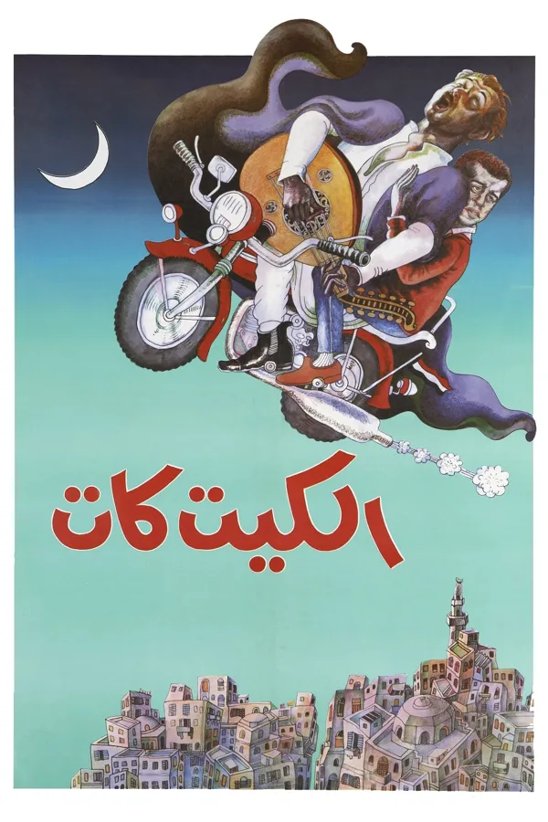

# كل الأفلام

<a class="film-card" href="../films/laila-1927/">١٩٢٧ليلىستيفان روستي</a>
<a class="film-card" href="../films/al-azima-1939/">١٩٣٩العزيمةكمال سليم</a>
<a class="film-card" href="../films/bab-el-hadid-1958/">١٩٥٨باب الحديديوسف شاهين</a>
<a class="film-card" href="../films/al-momia-1969/">١٩٦٩المومياءشادي عبد السلام</a>
<a class="film-card" href="../films/al-ard-1970/">١٩٧٠الأرضيوسف شاهين</a>
<a class="film-card has-poster" href="../films/el-kitkat-1991/">١٩٩١الكيت كاتداود عبد السيد</a>
<a class="film-card" href="../films/al-horoub-1991/">١٩٩١الهروبعاطف الطيب</a>
<a class="film-card" href="../films/ded-al-hokuma-1992/">١٩٩٢ضد الحكومةعاطف الطيب</a>

